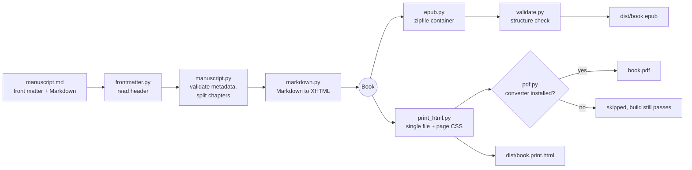

# book-pipeline

**You write the book in one plain text file. One command turns it into an ebook and a print layout, and refuses to hand you a broken ebook.**

For authors and small publishers who are tired of keeping a Word file, an ebook export and a print layout in step by hand. Fix a typo once in the manuscript, run the build again, and every format is current.

What comes out of one Markdown manuscript:

- **An EPUB 3 ebook** with a title page, a linked table of contents and one file per chapter.
- **A print layout** as a single HTML file: trim size, mirrored margins, page numbers, each chapter opening on a right hand page.
- **A PDF of that layout**, if a converter (WeasyPrint, wkhtmltopdf, or Chrome or Edge) is on the machine. Without one the step is skipped and the rest still builds.
- **A check on every build.** The EPUB is opened again and inspected; if a chapter is missing or the package is malformed, the command fails instead of shipping it.

It is pure Python standard library: nothing to install, no accounts, no network calls.

## What you will see

Real output from `python -m book_pipeline build` on the sample book (file list shortened):

```
Book      The Lamp at Greywater Point by Anonymous (en, 1897-03-01)
Chapters  4 (632 words)
          1. Preface (28 words)
          2. The Keeper (173 words)
          3. The Storm (285 words)
          4. The Morning (146 words)
EPUB      the-lamp-at-greywater-point.epub
          mimetype                     stored       20 bytes
          META-INF/container.xml       deflated    252 bytes
          OEBPS/content.opf            deflated   1627 bytes
          ...
Check     structure OK
Print     the-lamp-at-greywater-point.print.html (page size 5.5in 8.5in)
PDF       skipped: no converter found (looked for weasyprint, wkhtmltopdf, chromium)
```

And the check doing its job, from the demo, after a chapter is deleted from a copy of that EPUB:

```
$ python -m book_pipeline check broken.epub
- mimetype must be stored without compression
- manifest item ch003 points at missing file OEBPS/chapter-003.xhtml
2 problem(s)
```

The full transcript is in [`demo/output.txt`](demo/output.txt); CI reruns the demo on every push.

## Run it

Needs Python 3.10 or newer. Nothing to install.

```
python -m book_pipeline build
```

That builds `manuscript/sample.md` into `dist/`. To build your own book and check any EPUB:

```
python -m book_pipeline build path/to/book.md --out dist
python -m book_pipeline check dist/your-book.epub
```

Add `--no-pdf` to skip the PDF step. `pip install .` is optional and adds a `book-pipeline` command that takes the same arguments.

Exit codes: 0 success, 1 the EPUB failed its check, 2 the manuscript could not be read, 3 a PDF converter was found but failed. A missing converter is a skip, not a failure.

### Manuscript format

```
---
title: The Lamp at Greywater Point
author: Anonymous
language: en
date: 1897-03-01
trim: 5.5in 8.5in
---

# Chapter title

Paragraphs, *emphasis*, **strong**, > quotes, lists, `* * *` scene breaks.
```

Only `title` is required. Each level one heading starts a chapter. Text before the first heading becomes a preface. Other header fields that are used: `subtitle`, `description`, `rights`, `identifier`.

The sample manuscript in `manuscript/sample.md` is a short original tale written for this repository.

### Configuration

All optional, read from environment variables (see `.env.example`):

| Variable | Meaning |
| --- | --- |
| `BOOK_PDF_CONVERTER` | `auto` (default), `none`, `weasyprint`, `wkhtmltopdf` or `chromium`. |
| `BOOK_PDF_BINARY` | Full path to wkhtmltopdf or the browser when it is not on `PATH`. |

On Windows, Chrome and Edge are normally not on `PATH`, so `auto` will not find them. Set `BOOK_PDF_CONVERTER=chromium` and point `BOOK_PDF_BINARY` at `chrome.exe` or `msedge.exe`.

## How it works



| Module | Job |
| --- | --- |
| `book_pipeline/frontmatter.py` | Reads the `key: value` header (strings, inline lists, dash lists). |
| `book_pipeline/markdown.py` | Small Markdown to XHTML converter for prose. |
| `book_pipeline/manuscript.py` | Validates metadata, splits chapters on `#` headings, builds the `Book`. |
| `book_pipeline/epub.py` | Renders the package files and writes the zip container: stored `mimetype` entry first, `container.xml`, package document, navigation document, an NCX for older readers, one XHTML file per chapter, a stylesheet. |
| `book_pipeline/validate.py` | Checks an EPUB's structure; also available as the `check` command. |
| `book_pipeline/print_html.py` | Renders the print file with `@page` rules. |
| `book_pipeline/pdf.py` | Finds a converter and runs it; never required. |
| `book_pipeline/cli.py` | The `build` and `check` commands. |

Builds are repeatable: the same manuscript gives a byte identical EPUB on the same Python build, because archive timestamps and the book identifier are fixed. A test builds twice and compares the bytes.

## Tests

```
python -m unittest discover -s tests -v
```

40 tests, standard library only. They cover the front matter reader, the Markdown converter, chapter splitting, word counts, the EPUB structure (mimetype position and raw bytes, container, metadata, manifest, spine, navigation, well formed XHTML, repeatable output), a set of deliberately damaged EPUBs that the checker must reject, the print CSS, the PDF step through a fake converter, and the command line with its exit codes. CI in `.github/workflows/ci.yml` runs the tests, the demo and a sample build on Linux and Windows, Python 3.10 and 3.12.

## Demo

```
python demo/run_demo.py
```

Runs offline. It builds the sample book, prints the package document and the page rules, then removes a chapter from a copy of the EPUB and shows the checker catching it. It rewrites `demo/output.txt` each time.

## Where this pattern runs

This is a cleaned up, generic version of a pattern from the systems that run two small service companies day to day: one plain text source, several output formats, and a check that gates every build. All code and sample text here were written fresh for this repository.

## Limitations

What has and has not been proven:

- **Store and printer acceptance is not tested or claimed.** Nothing in this repository submits a file to an ebook store or a print service, and no result from one is recorded here.
- **The EPUB check is this project's own structural check, not EPUBCheck.** It covers the mimetype entry, container, metadata, manifest, spine, navigation and well formed XHTML. The official EPUBCheck validator is not run by the tests or CI; run it yourself before submitting to a store.
- **The "print layout" is HTML, not a press ready PDF.** There is no bleed, no crop marks, no PDF/X output and no embedded fonts (it asks for Georgia, then Times New Roman, then the system serif).
- **PDF conversion has had one real run.** Chrome 158 on Windows produced an 8 page PDF at the 5.5 x 8.5 inch trim size from the sample; the page size and count were read from the file, the pages were not proofed by eye. WeasyPrint and wkhtmltopdf have never been run for real: their command lines are only exercised in unit tests through a fake converter.
- **Print fidelity depends on the converter.** The page CSS uses paged media features (margin boxes, `leader()`, `target-counter()`) that dedicated print engines honour; browsers ignore some, so a browser made PDF may lack page numbers in the contents. wkhtmltopdf ignores most `@page` rules.
- **Only tried on a 632 word sample.** No full length manuscript has been built or timed.
- **Markdown coverage is prose only:** headings, paragraphs, hard breaks, emphasis, links, block quotes, flat lists, fenced code and scene breaks. No tables, footnotes, nested lists, images or raw HTML. Chapter titles are plain text, so `*emphasis*` in a title shows its asterisks.
- **No cover image, images or embedded fonts** in the EPUB.
- **The header reader handles a small subset of YAML.** Nested mappings and multi line strings are not supported.
- **Metadata is minimal.** One author string, no ISBN field beyond a free form `identifier`, and `dcterms:modified` is the book's `date` at midnight rather than the build time (that is what keeps builds repeatable).
- **Output file names come from the title's ASCII letters,** so a title in another script is written as `book.epub`.
- **Byte identical output is only promised for the same Python and zlib build;** a different zlib can compress differently.

License: MIT, see the LICENSE file.
