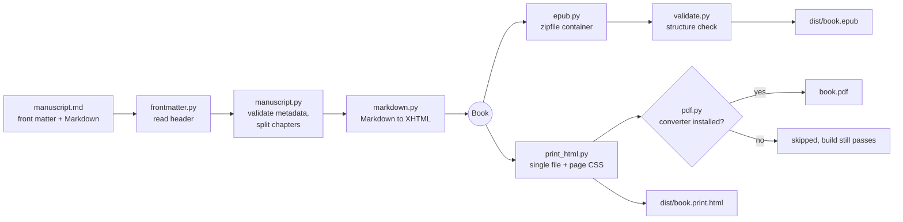

# book-pipeline

Turning a manuscript into files a reader, a printer and a store will each accept usually means three tools and a lot of hand fixing.
This repository does it with one command and no dependencies beyond the Python standard library.

## What it does

A single Markdown file with a front matter header goes in. Out come:

- **EPUB 3** (`.epub`), written with the standard library `zipfile` module: stored `mimetype` entry first, `META-INF/container.xml`, package document, navigation document, an NCX for older readers, one XHTML file per chapter and a stylesheet.
- **Print ready HTML** (`.print.html`): the whole book in one file with CSS paged media rules for trim size, mirrored margins, page numbers and chapter openings on a right hand page.
- **PDF** (`.pdf`), only when a converter is installed: WeasyPrint, wkhtmltopdf or a Chromium family browser. With none present the step reports `skipped` and the build still succeeds.

Every build then runs a structural check on the EPUB it just wrote and fails the command if anything is wrong. Builds are repeatable: the same manuscript gives a byte identical EPUB on the same Python build, because timestamps and the book identifier are fixed.

The sample manuscript in `manuscript/sample.md` is a short original tale written for this repository in a public domain style.

## Architecture



| Module | Job |
| --- | --- |
| `book_pipeline/frontmatter.py` | Reads the `key: value` header (strings, inline lists, dash lists). |
| `book_pipeline/markdown.py` | Small Markdown to XHTML converter that always emits well formed XML. |
| `book_pipeline/manuscript.py` | Validates metadata, splits chapters on `#` headings, builds the `Book`. |
| `book_pipeline/epub.py` | Renders the package files and writes the zip container. |
| `book_pipeline/validate.py` | Checks an EPUB's structure; also available as the `check` command. |
| `book_pipeline/print_html.py` | Renders the print file with `@page` rules. |
| `book_pipeline/pdf.py` | Finds a converter and runs it; never required. |
| `book_pipeline/cli.py` | The `build` and `check` commands. |

## Run it

Needs Python 3.9 or newer. Nothing to install.

```
python -m book_pipeline build
```

That builds `manuscript/sample.md` into `dist/`. To build your own book and check any EPUB:

```
python -m book_pipeline build path/to/book.md --out dist
python -m book_pipeline check dist/your-book.epub
```

Add `--no-pdf` to skip the PDF step. Exit codes: 0 success, 1 the EPUB failed its check, 2 the manuscript could not be read.

### Manuscript format

```
---
title: The Lamp at Greywater Point
author: Anonymous
language: en
date: 1897-03-01
trim: 5.5in 8.5in
---

# Chapter title

Paragraphs, *emphasis*, **strong**, > quotes, lists, `* * *` scene breaks.
```

Only `title` is required. Each level one heading starts a chapter. Text before the first heading becomes a preface.

### Configuration

All optional, read from environment variables (see `.env.example`):

| Variable | Meaning |
| --- | --- |
| `BOOK_PDF_CONVERTER` | `auto` (default), `none`, `weasyprint`, `wkhtmltopdf` or `chromium`. |
| `BOOK_PDF_BINARY` | Full path to the converter when it is not on `PATH`. |

No API keys or network access are used anywhere.

## Tests

```
python -m unittest discover -s tests -v
```

34 tests, standard library only. They cover the front matter reader, the Markdown converter, chapter splitting, the EPUB structure (mimetype position and raw bytes, container, metadata, manifest, spine, navigation, well formed XHTML, repeatable output), a set of deliberately damaged EPUBs that the checker must reject, the print CSS, the PDF step through a fake converter, and the command line. CI in `.github/workflows/ci.yml` runs the tests, the demo and a sample build on Linux and Windows.

## Demo

```
python demo/run_demo.py
```

The demo runs offline. It builds the sample book, prints the package document and the page rules, then removes a chapter from a copy of the EPUB and shows the checker catching it. The captured transcript is in [`demo/output.txt`](demo/output.txt). The closing lines look like this:

```
== 4. Damage the EPUB and run the checker again ==
$ python -m book_pipeline check broken.epub
- mimetype must be stored without compression
- manifest item ch003 points at missing file OEBPS/chapter-003.xhtml
2 problem(s)
```

## Where this pattern runs

This is a cleaned up, generic version of a pattern drawn from systems that run two small service companies day to day. There, the same shape (one plain text source, several output formats, a check that gates every build) produces long form documents without anyone touching a layout program. All code and sample text here were written fresh for this repository.

## Limitations

- The EPUB check is structural. It is not a substitute for a full conformance checker such as EPUBCheck, and it does not validate XHTML against the content model, only that it is well formed.
- The Markdown converter covers prose: headings, paragraphs, hard breaks, emphasis, links, block quotes, flat lists, fenced code and scene breaks. No tables, footnotes, nested lists, images or raw HTML.
- The front matter reader handles a small subset of YAML. Nested mappings and multi line strings are not supported.
- No cover image, embedded fonts or image handling yet.
- Print quality depends on the converter. The page CSS uses paged media features (margin boxes, `leader()`, `target-counter()`) that dedicated print engines honour; browsers ignore some of them, so a browser made PDF may lack contents page numbers. wkhtmltopdf ignores most `@page` rules.
- The PDF step was exercised locally with a Chromium family browser only. The WeasyPrint and wkhtmltopdf command lines are covered by unit tests through a fake converter, not by real runs.
- Byte identical output is only promised for the same Python and zlib build; a different zlib can compress differently.

License: MIT, see the LICENSE file.
